<div align="center">

# 🤖 101GPT 模型接入保姆级指南（一知未来）

**从注册到多智能体调用，几分钟内完成** · 注册 → 充值 → 创建密钥 → 拿到凭证

[📖 网页版指南](readme.html) · [📊 A股量价TOP20看板](index-top20.html) · [🌐 AI中台](https://101gpt.cc)

</div>

---

> 🚀 **快速四步走**：注册 → 充值 → 创建密钥 → 拿到凭证。下方「一、」拿到你的 Base URL 与 API Key 后，即可在任意兼容 OpenAI 的智能体中接入 101GPT；如需把 101GPT 接入 ChatGPT / Claude / WorkBuddy / TraeWork 等更多智能体，继续看「二 ~ 五、」。

---

## 一、101GPT API 获取（注册 · 充值 · 创建密钥）

### 01 · 注册账号

使用常用邮箱注册并登录控制台。

👉 **注册入口**：<https://101gpt.cc/register?aff=3KDMPTVKGK29>

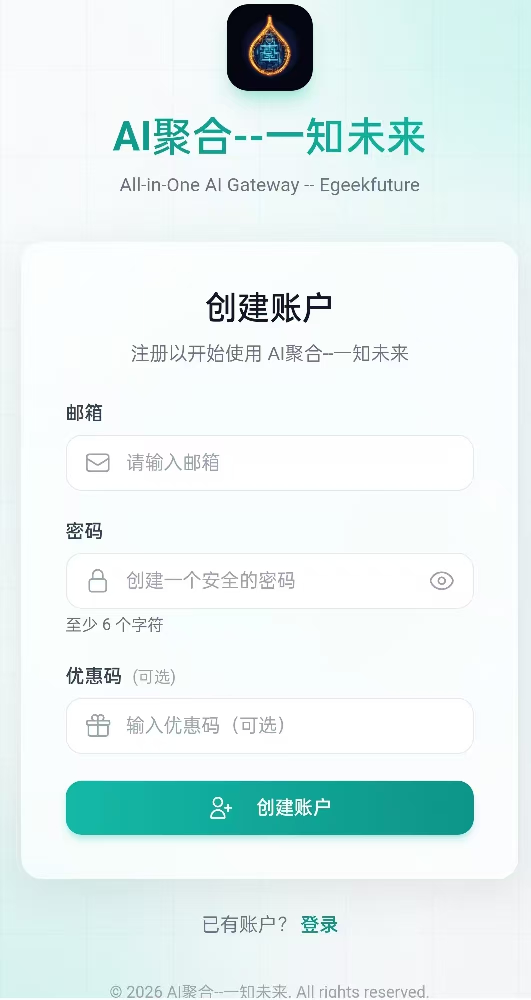

### 02 · 兑换或充值

有兑换码填码兑换，或者按需充值或订阅套餐。

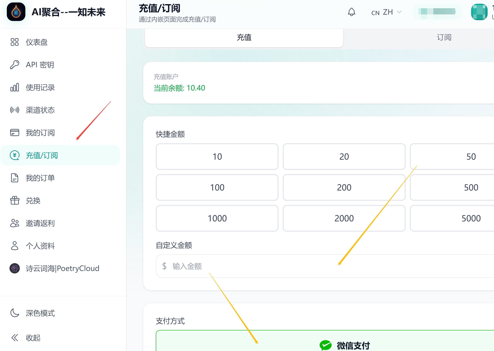

> 💡 **提示**：根据控制台展示的模型价格充值。余额按实际调用量扣除，余额可跨月使用。

### 03 · 创建密钥

进入 API Key 页面创建密钥，并设置名称、选好分组，确定创建。

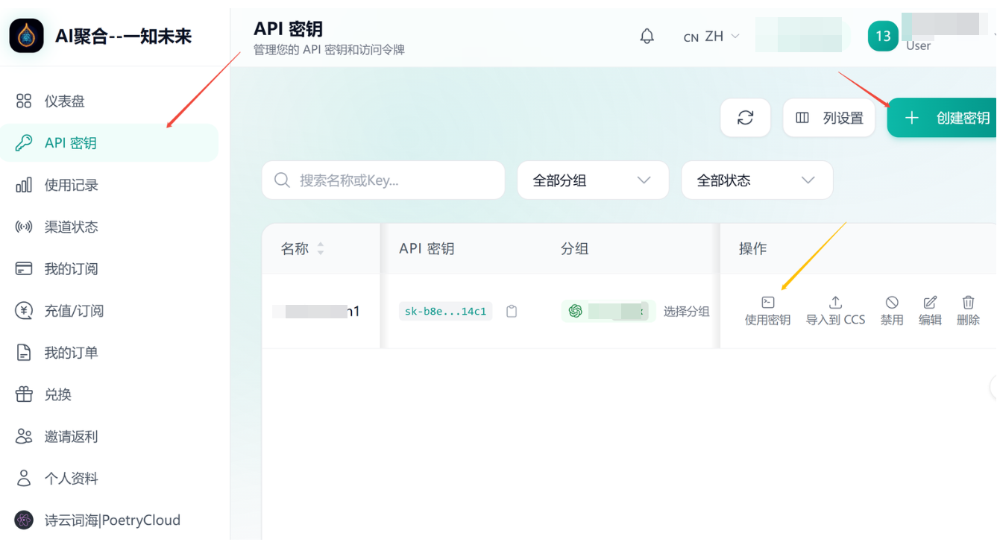

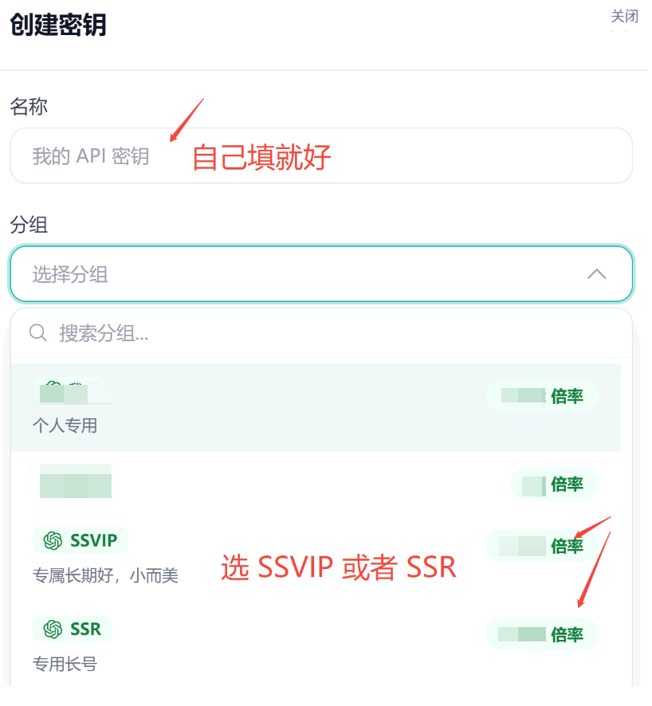

### 04 · 开始调用

使用密钥，复制你的 **Base URL** 和 **API Key** —— 这是你调用 101GPT 最重要的两样信息。

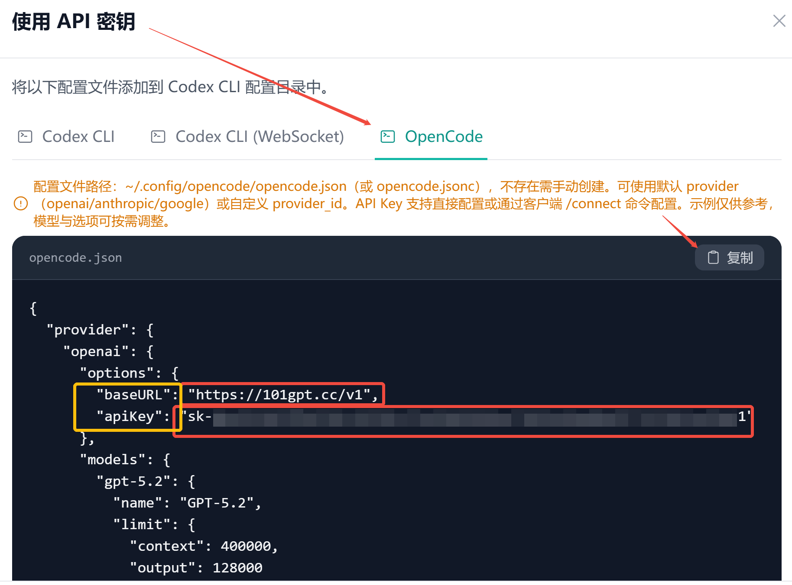

> ⚠️ **重要**：这个代码中最重要的信息，就是你的 **apiKey**，记得不要泄露给其他人哦。而 **baseURL** 对应就是大模型供应商链接 `https://101gpt.cc/v1`

你在这里也可以直接复制保存你的 **apiKey**。

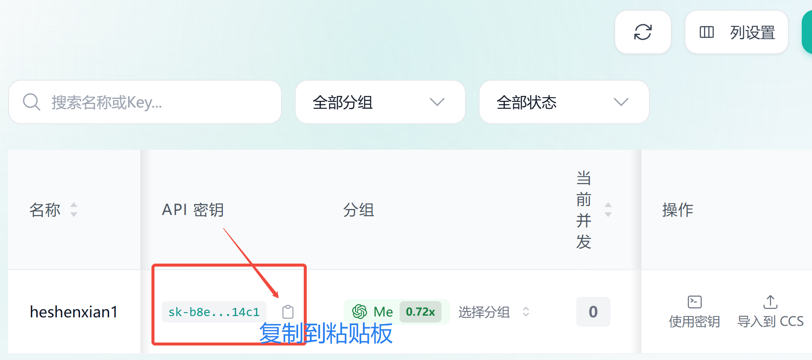

> 💡 拿到这两样信息后，即可在任意兼容 OpenAI 的智能体中接入 101GPT（OpenCode、WorkBuddy、TraeWork、DeepSeek Harness 等），具体配置方法见下方「五、主流智能体配置方法」。

---

## 📌 补充：手动添加供应商与 API Key

调用你的 API，你手上有两个关键信息：

| 信息 | 值 |
|------|-----|
| **baseURL**（模型供应商链接） | `https://101gpt.cc/v1` |
| **apiKey**（API密钥，需自行保管） | `sk-` 开头的字段 |

手动添加供应商：左下角 ⚙️ 设置里点开，再选择「供应商」→「自定义供应商」。

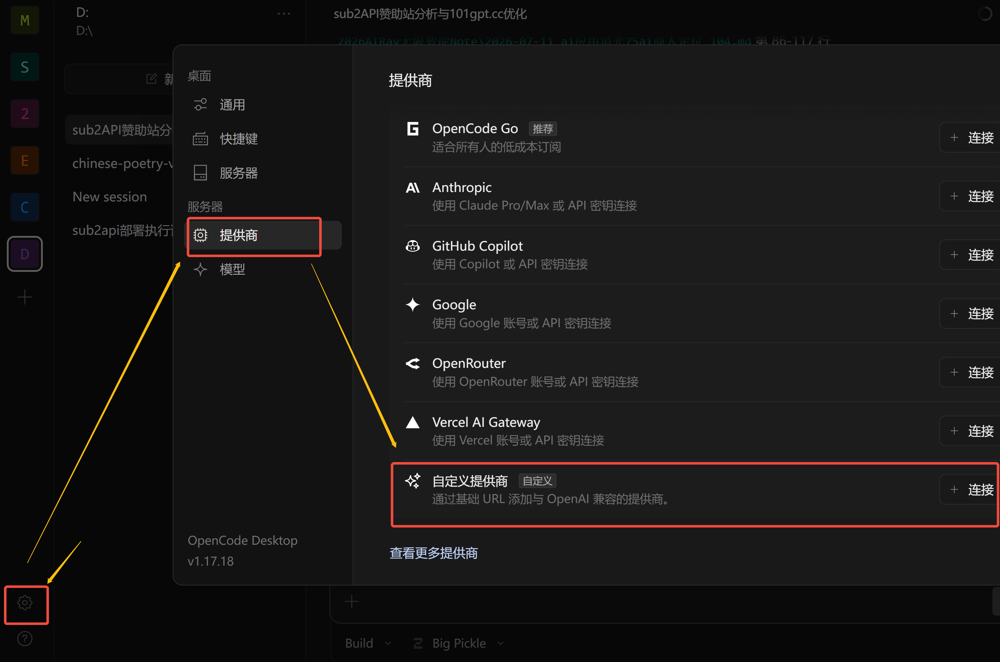

> 💡 **提示**：供应商信息如供应商 ID、现实名称可以你自己填，比如咱们站你可以填 **101gpt**。而基础 URL、API 密钥上面都提到了。模型部分可填可不填。由于 OpenCode 是智能体，建议你遇事不决，就问它解决是聪明办法。

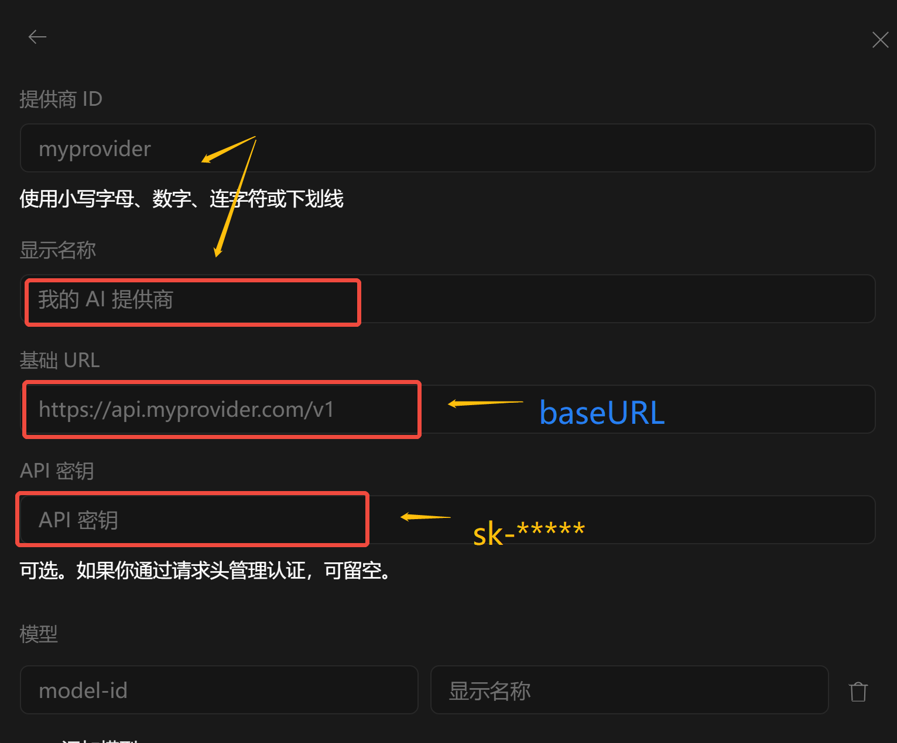

> 🔄 **新手必看 · 重启后生效**：保存自定义供应商与 API Key 后，请**彻底退出并重新打开 OpenCode**（不是只关窗口，要结束进程），新的 AI 模型列表才会加载；只关窗口不重启，可能看不到刚加的模型。

---

## 二、ChatGPT(Codex) 安装方法

从 Windows 应用商店（Microsoft Store）搜索并下载 ChatGPT（原名 Codex）。

从 Windows 菜单里找到 Microsoft Store 并打开，在界面上搜索 ChatGPT，如下图：

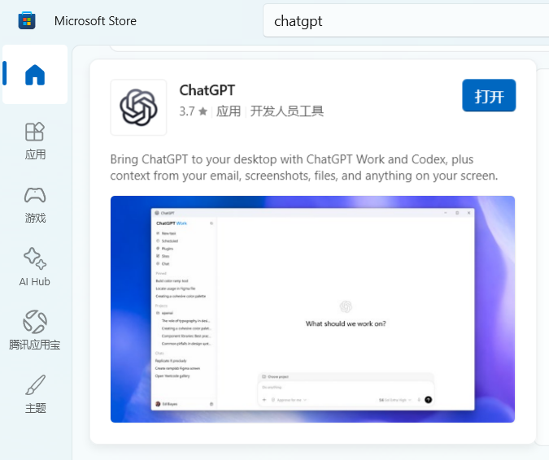

> 💡 **说明**：近期 ChatGPT 更新频繁，建议大家使用最新版。

> ⚠️ 安装好先别打开，配置好 API Key 以后再进入（配置方法见下一节「三、」）。

---

## 三、ChatGPT(Codex) 配置方法

有两种方式可以配置 ChatGPT（以下 2 选 1 即可）：

- 一种是借助工具 **CC Switch**，同时使用多种模型（例如同时使用 GPT、Claude、Gemini、DeepSeek），方法简单，**建议采用**。
- 另一种是手动配置方法，自己编辑 ChatGPT 的配置文件，只用 GPT 模型，方法稍微复杂。

### 方式 1 —— CC Switch 配置方法（推荐）

CC Switch 官方网站下载：<https://ccswitch.io/zh/download>

安装并运行 CC Switch，在界面点击 ChatGPT 图标（选择目标应用为 ChatGPT），再点击「增加」图标，如下图：

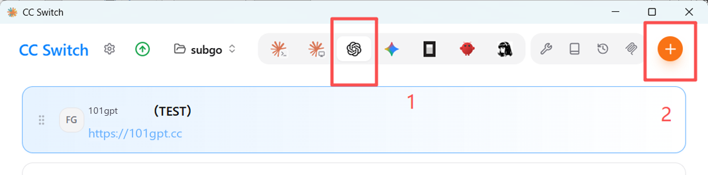

选择「自定义配置」后，页面往下翻，按图示填写相关信息：

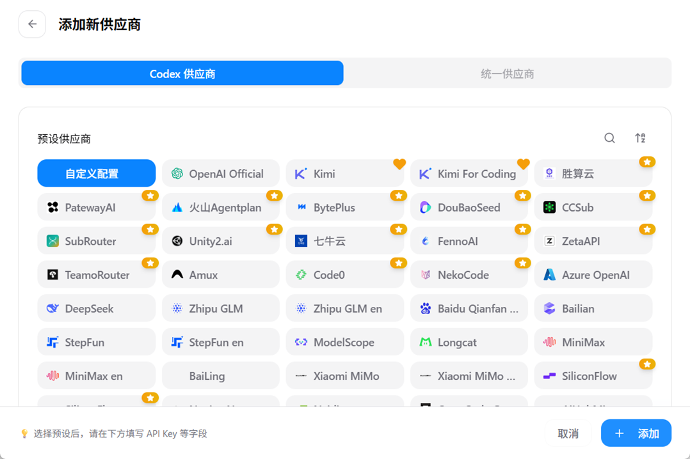

| 字段 | 值 |
|------|-----|
| **供应商名称** | 101gpt |
| **官网地址** | <https://101gpt.cc> |
| **API Key** | 从 https://101gpt.cc 获取的，以 `sk-` 开头，不带引号 |
| **API 请求地址（Base URL）** | `https://101gpt.cc/v1` |

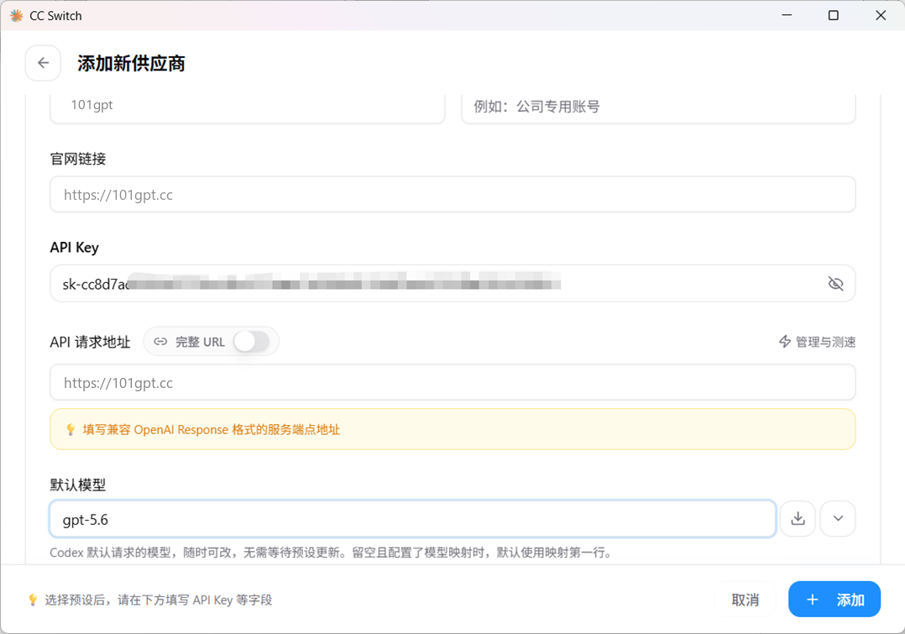

添加后回到主界面，按「启用」按钮，重新启动 ChatGPT(Codex) 即可。

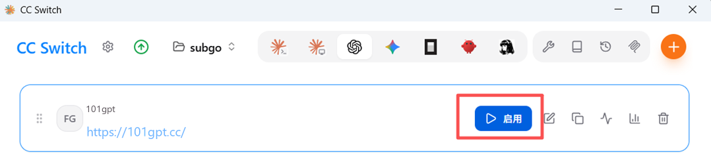

> 💡 利用 CC Switch 可以配置多个 API 来源进行自由切换模型，支持国内外主流大语言模型。

> 🔄 **新手必看 · 重启后生效**：在 CC Switch 点击「启用」后，请**彻底退出并重新打开 ChatGPT(Codex)**，新的 AI 模型列表才会加载生效。

### 方式 2 —— 手动配置方法

1. **操作配置文件**：打开并登录 <https://101gpt.cc>，左边菜单栏选择「API 密钥」，再选择其中一个密钥，点击「使用密钥」按钮，按下图示意进行选择并复制。

   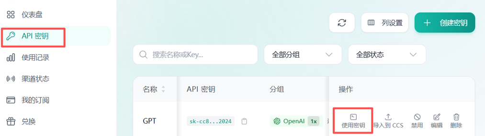
   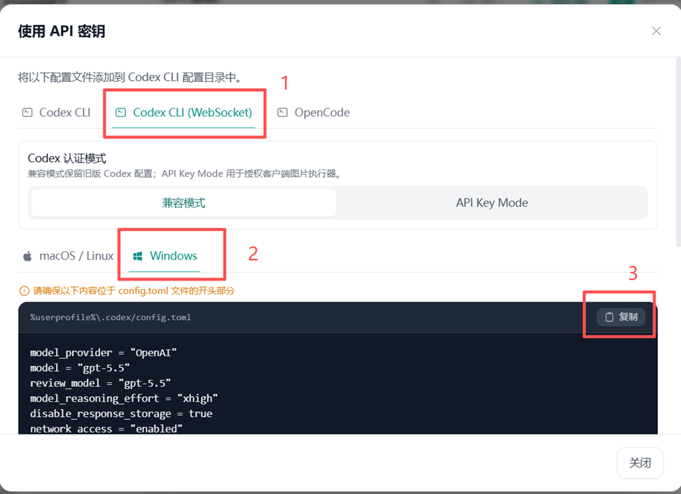

2. 按键盘 `Win + R`，输入 `notepad %userprofile%/.codex/config.toml`，按回车。

   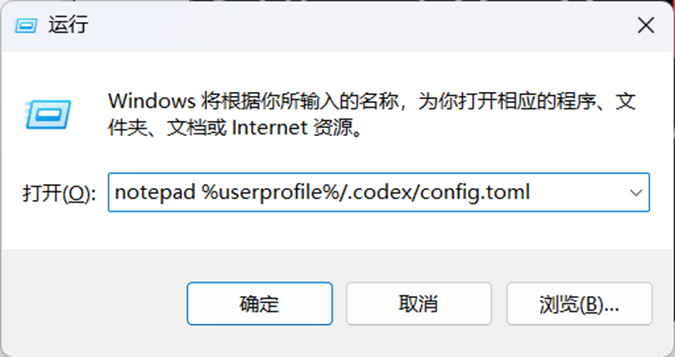

3. 用记事本打开配置文件以后，将刚刚从 101gpt.cc 复制过来的内容，粘贴到配置文件的最前面，保存（Ctrl+S）。

   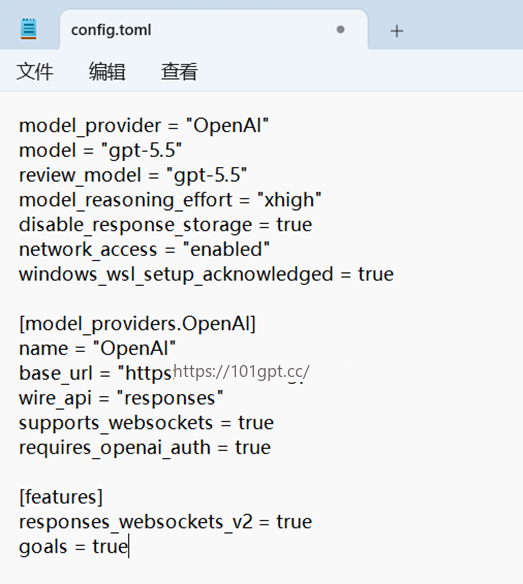

4. **操作密钥文件**：切换回 101gpt.cc 网页，在使用 API 密钥界面点击「复制」按钮复制密钥。再按 `Win+R` 输入 `notepad %userprofile%/.codex/auth.json` 打开密钥文件，将复制的密钥粘贴进去并保存。

   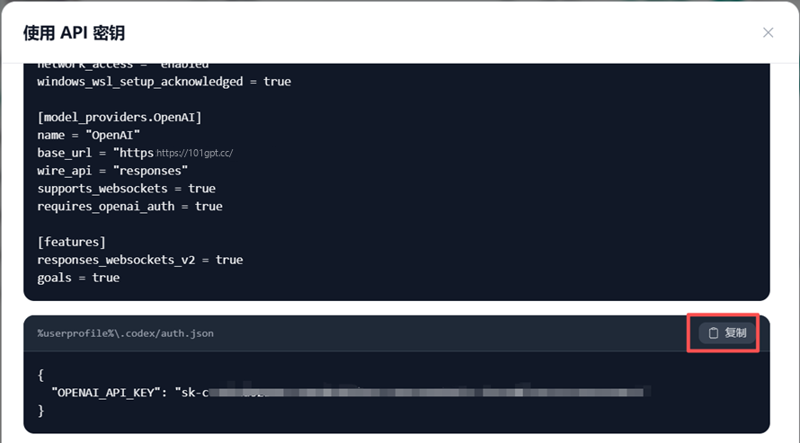
   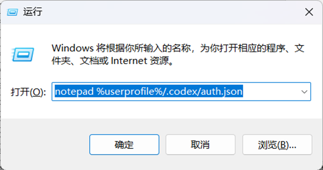
   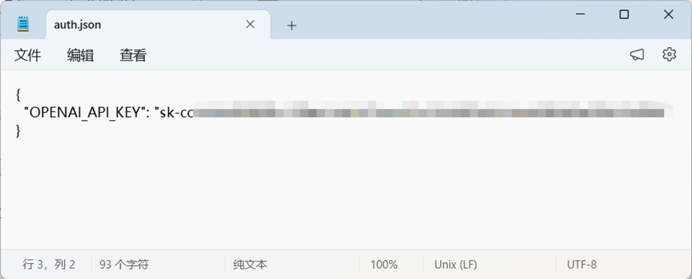

5. 在 Windows 菜单中找到并打开 ChatGPT 就可以用了。

> 🔄 **新手必看 · 重启后生效**：手动改完 `config.toml` 和 `auth.json` 并保存后，如果 ChatGPT 还开着，请**彻底退出并重新打开**，新的 AI 模型列表才会加载生效。

---

## 四、Claude 安装和配置方法

1. **下载 Claude**：在 Windows 中打开 Microsoft Store 并搜索 Claude，或者到官网下载（<https://claude.com>）。

   

2. **安装 CC Switch**：下载地址 <https://ccswitch.io/zh/download>。

3. **在 CC Switch 中配置 Claude Desktop**（Claude Code 方法类似）：选择 Claude Desktop，再添加供应商，在「添加供应商」界面选择「自定义配置」。

   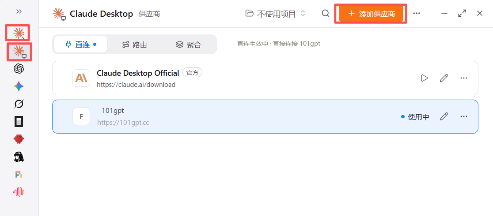
   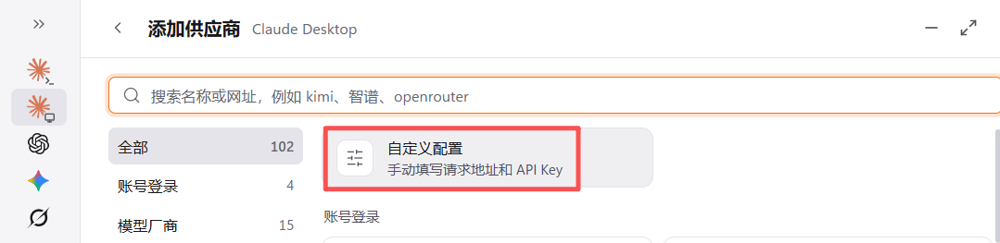

4. 其它参数配置（红色框中必填）：API Key 是从 <https://101gpt.cc> 站点获取的 API Key（**创建 API Key 时必须选 Claude 类分组**），再点击保存即可。

   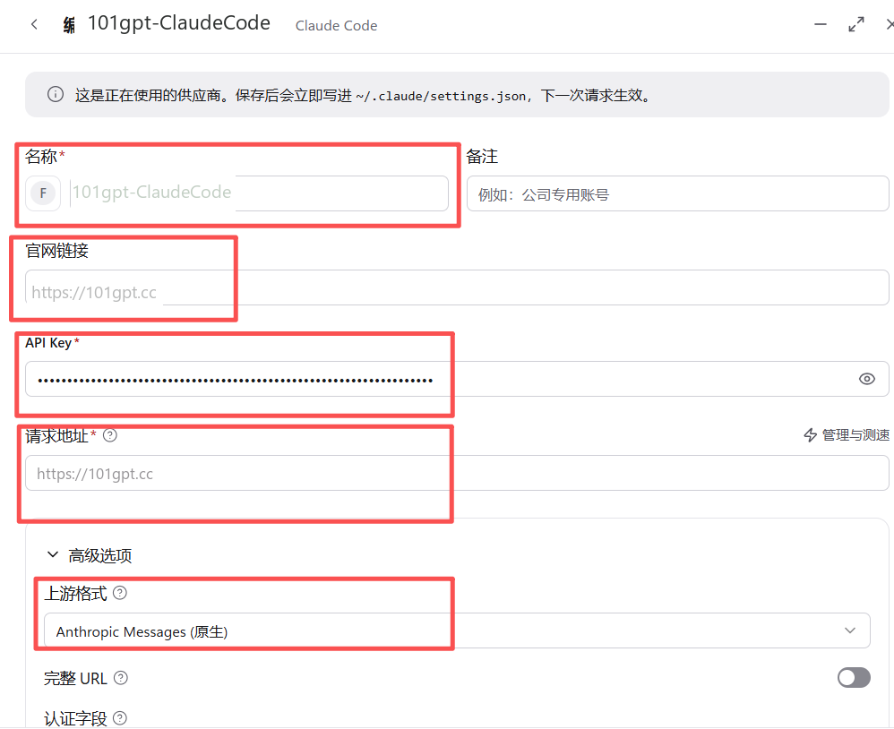
   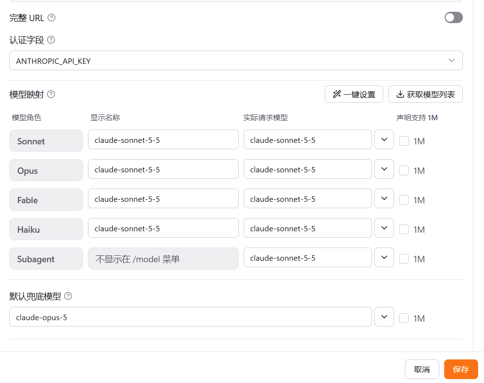

5. 在 Windows 中打开 Claude Desktop（或 Claude Code）就可以使用了。

> 🔄 **新手必看 · 重启后生效**：在 CC Switch 保存配置后，请**彻底退出并重新打开 Claude Desktop（或 Claude Code）**，新的 AI 模型列表才会加载生效。

| 字段 | 值 |
|------|-----|
| **供应商名称** | 101gpt |
| **官网地址** | <https://101gpt.cc> |
| **API Key** | 从 https://101gpt.cc 获取，创建时选 Claude 类分组，以 `sk-` 开头 |
| **API 请求地址（Base URL）** | `https://101gpt.cc/v1`（OpenAI 兼容接口；若用 Claude Code 原生协议，则为 `https://101gpt.cc`，**不带 /v1**） |

### 方式二 —— Claude Code 命令行配置（环境变量）

如果你用 **Claude Code**（命令行工具），101GPT 走 Anthropic **原生协议**接入，**Base URL 不带 `/v1`**。在终端（或写入 `~/.bashrc` / `~/.zshrc` / Windows 用户环境变量）设置以下环境变量：

```bash
export ANTHROPIC_BASE_URL="https://101gpt.cc"
export ANTHROPIC_AUTH_TOKEN="sk-2b****"
export CLAUDE_CODE_DISABLE_NONESSENTIAL_TRAFFIC=1
```

- `ANTHROPIC_BASE_URL`：填 `https://101gpt.cc`（**没有** `/v1` 后缀，这是 Anthropic 原生接口地址）。
- `ANTHROPIC_AUTH_TOKEN`：填从 101gpt.cc 获取的 API Key（**创建时必须选 Claude 类分组**，以 `sk-` 开头）。
- `CLAUDE_CODE_DISABLE_NONESSENTIAL_TRAFFIC=1`：关闭 Claude Code 向 Anthropic 官方发送的非必要遥测/心跳流量，确保请求全部走 101GPT。

保存后在终端重新加载配置（或新开终端），运行 `claude` 即可使用 101GPT 提供的 Claude 系列模型。

---

## 五、主流智能体配置方法

> 💡 以下均为「按需选配」。无论接哪个智能体，你都需要先在 <https://101gpt.cc> 创建好 API Key（按所用模型家族选对应分组），再填入对应工具的 Base URL 与密钥。

> 🔄 **新手必看 · 重启后生效**：无论接入下面哪个智能体，填完 API Key / Base URL / 模型信息后，都要**彻底退出并重新打开该软件**（不是只关窗口，要结束进程），新的 AI 模型列表才会加载生效。**这是新手最容易漏掉的一步！**

### 1、配置 WorkBuddy（按需选配）

腾讯 WorkBuddy 下载地址：<https://www.codebuddy.cn/work/>。在对话框右下方选择「配置自定义模型」，在对话框里选择「+添加模型」。

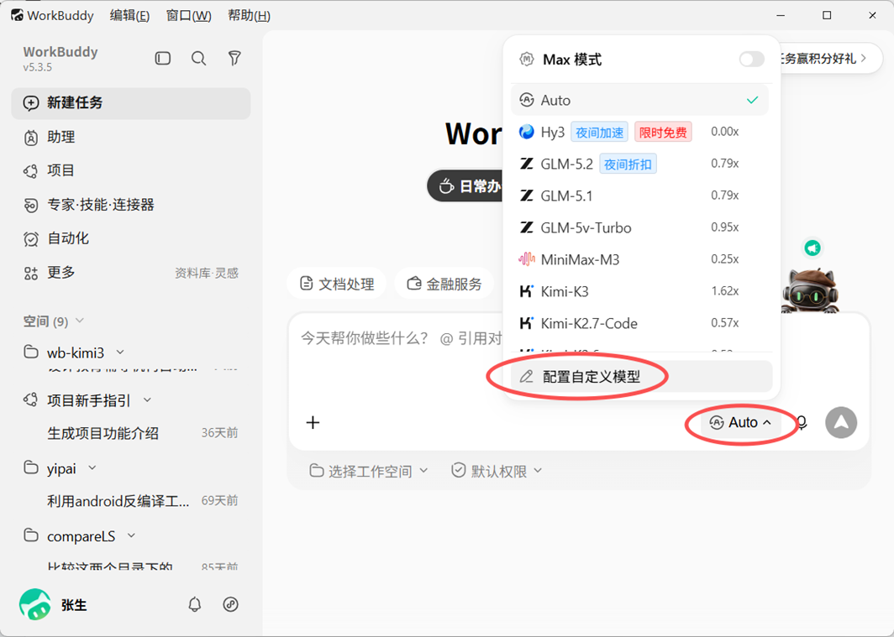
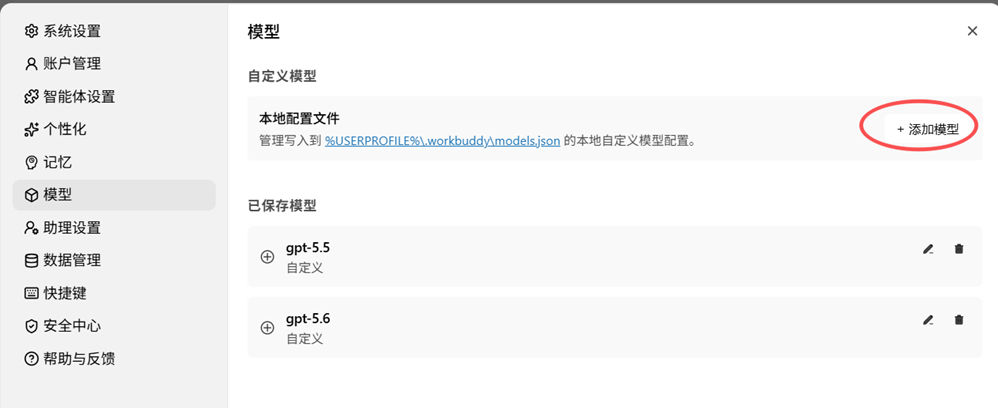

在「添加模型」或「编辑模型」对话框中输入以下信息：

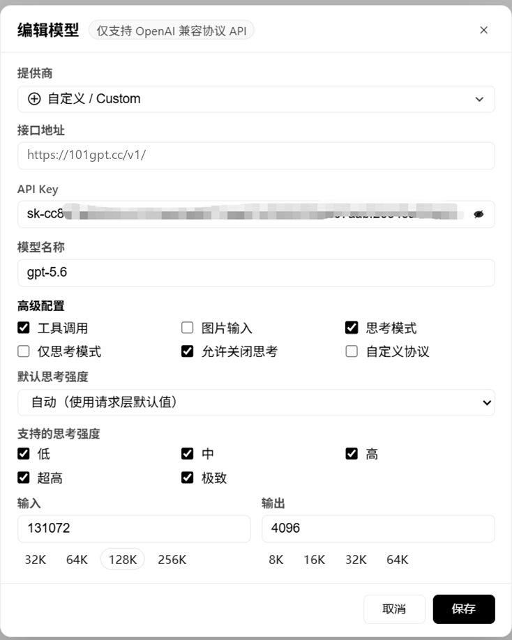

| 字段 | 值 |
|------|-----|
| **提供商** | 自定义 / Custom |
| **接口地址（不能填错）** | `https://101gpt.cc/v1` |
| **API Key** | 填入从 101gpt.cc 获取的 API 密钥，以 `sk-` 开头 |
| **模型名称** | 可填 OpenAI 主流模型，例如 `gpt-5.6-sol gpt-5.6-terra gpt-5.6-luna gpt-6-astra gpt-6-sol gpt-6-luna gpt-6.1-sol gpt-6.1-terra`（也可填 101gpt 已接入的 claude-* / gemini-* / grok-* / deepseek-* 等模型） |

配置好以后，可以在 WorkBuddy 中选择该模型进行交互。

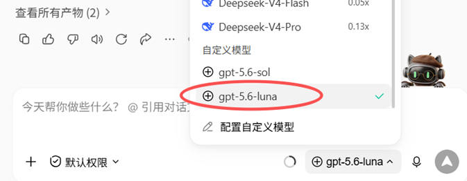

> 🔄 **新手必看 · 重启后生效**：保存自定义模型后，请**彻底退出并重新打开 WorkBuddy**，新添加的模型才会加载生效；重启后到模型选择处即可看到 101gpt 模型。

### 2、配置 OpenCode（按需选配）

**下载与安装**：前往 OpenCode 官网 <https://opencode.ai/zh> 下载对应系统版本，安装并启动 OpenCode。

初次启动后，「打开项目」就是选一个文件夹 📂 或者存储盘就好，智能体对具体的范围发挥智能，不会额外做功。小何在 Windows 电脑通常先选了 **D盘**，而苹果 Mac 通常选择 **Download 文件夹** 📂。

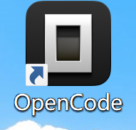
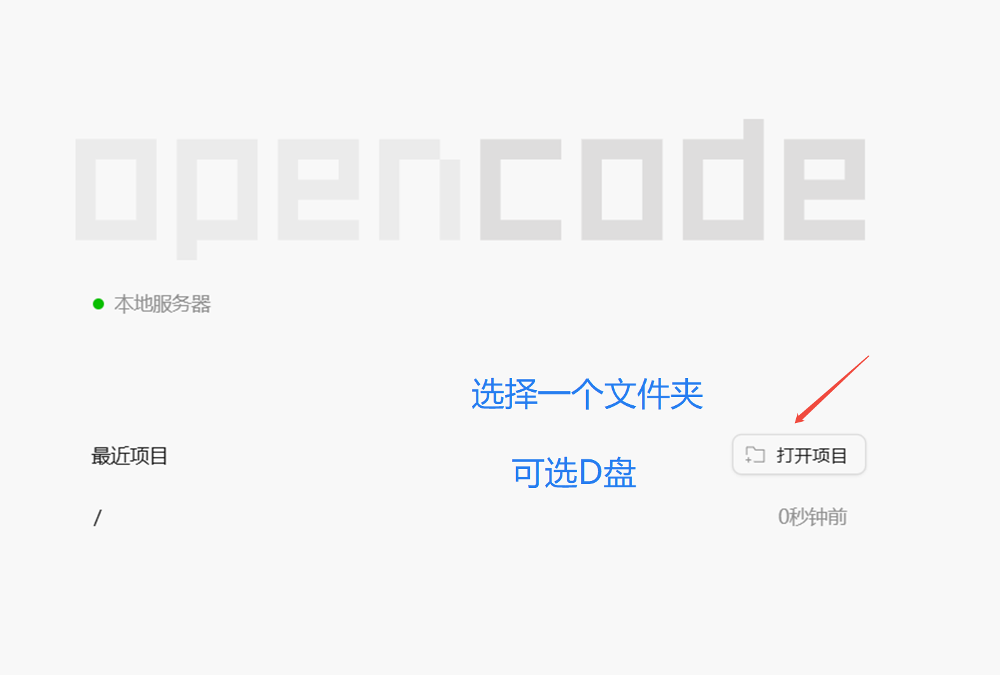

#### 方式一：一键接入（推荐）

在 101gpt 控制台「使用密钥」中复制配置代码（见上方「一、」步骤 04），直接 **Ctrl+V** 粘贴给 OpenCode 对话框，让它去配置好供应商 API，然后关闭 OpenCode，重新打开它。

> 💡 粘贴后，你在「选择模型」中就能看到 OpenAI 家的一流 AI 大模型了，比如 gpt-5.6 系列、gpt-6 系列。

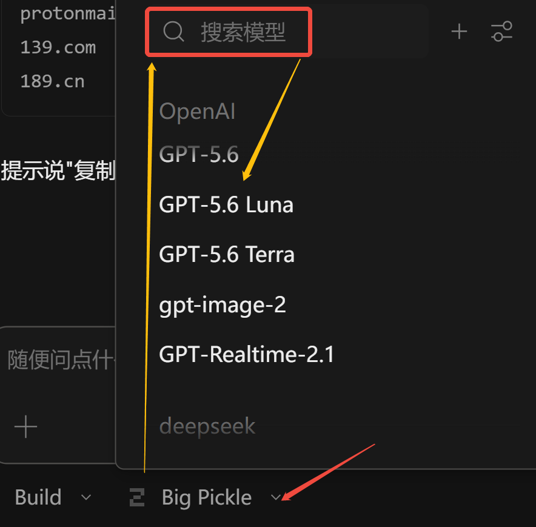

> 🔄 **新手必看 · 重启后生效**：粘贴配置后必须**彻底退出并重新打开 OpenCode**（不是只关窗口），新的 AI 模型列表才会加载。如果「选择模型」里没看到新模型，八成是没重启干净。

用上 OpenCode，开始用上你的 **AI数字员工**，让它给你干活吧！

#### 方式二：手动添加自定义提供商

在 OpenCode 主对话框下方选择模型下拉列表，选择「管理模型」，在管理模型对话框中选择「+连接提供商」，再选择「自定义 OpenAI 兼容提供商」。

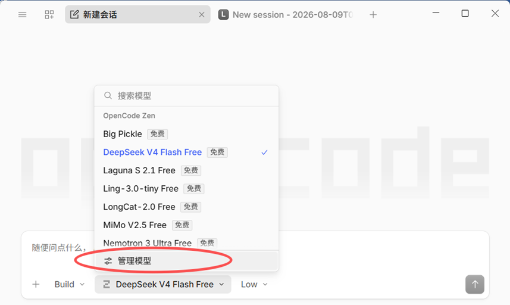
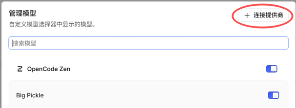
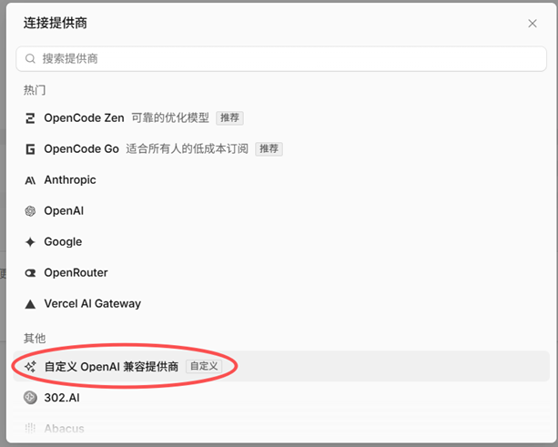

在自定义提供商对话框中输入以下信息：

| 字段 | 值 |
|------|-----|
| **提供商 ID** | 101gpt |
| **显示名称** | 101GPT |
| **基础 URL（不能填错）** | `https://101gpt.cc/v1` |
| **API 密钥** | 从 101gpt.cc 获取的 API 密钥（以 sk- 开头） |
| **模型** | 填入常见模型名称，例如 `gpt-5.6-sol gpt-5.6-terra gpt-5.6-luna gpt-6-astra gpt-6-sol gpt-6-luna gpt-6.1-sol gpt-6.1-terra`（及 claude-* / gemini-* / grok-* / deepseek-* 等 101gpt 已接入的模型） |

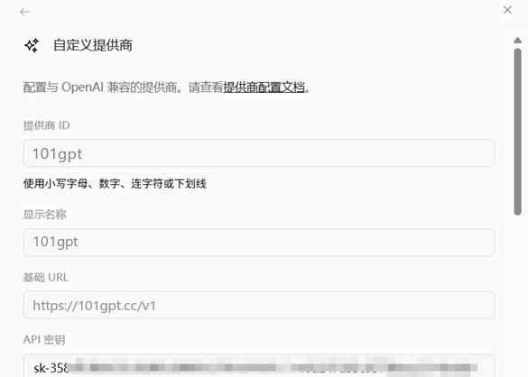
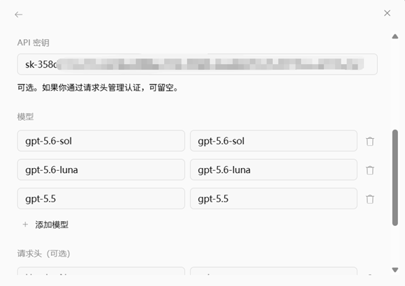
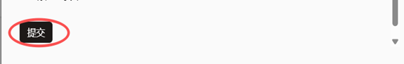

最后点击「提交」即可。配置好以后，在对话框下方就可以选择或搜索模型，在顶部搜索框中输入 `101gpt` 即可快速找到刚配置好的模型。

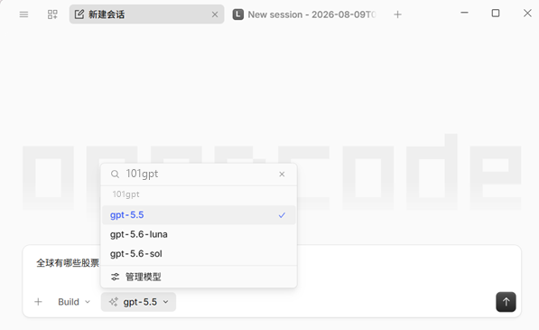

> 🔄 **新手必看 · 重启后生效**：手动填完 API Key、基础 URL 和模型、点击「提交」后，一定要**彻底退出并重新打开 OpenCode**（只关窗口不算，要在托盘或任务管理器里结束进程），新的 AI 模型列表才会加载出来。重启后在模型搜索框输入「101gpt」即可找到刚配好的模型。

### 3、配置 DeepSeek Harness（按需选配）

DeepSeek Harness 下载地址：<https://www.deepseek.com/harness/>。在配置页面，先在界面左下角点击「设置」，在设置对话框里选择「模型」，点击「添加提供方」。

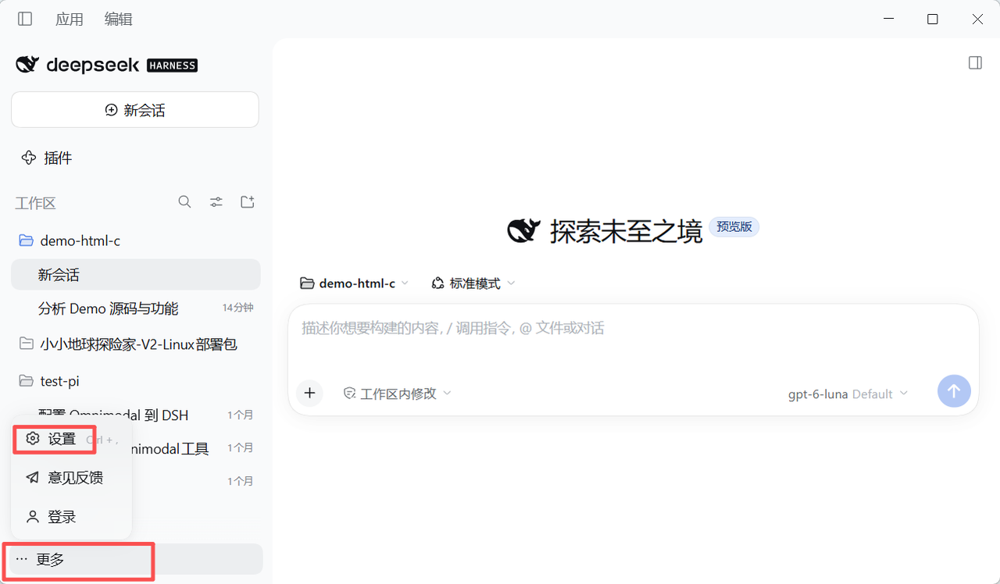
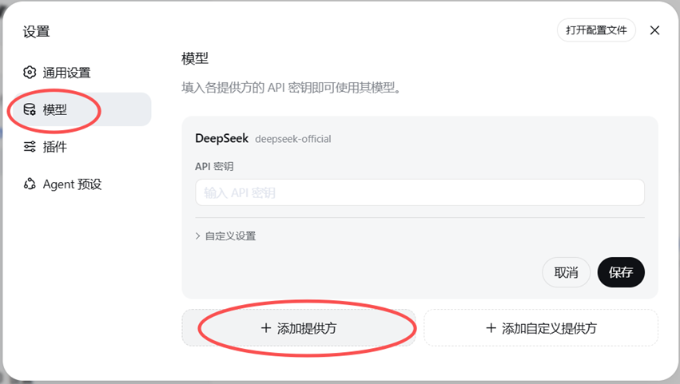

| 字段 | 值 |
|------|-----|
| **提供方** | 选择 openai 即可 |
| **API 密钥** | 以 `sk-` 开头的密钥，从 101gpt.cc 网站获取 |
| **自定义设置 → API 地址** | `https://101gpt.cc/v1` |
| **已自定义模型目录** | 填入常见 GPT 模型名称，例如 `gpt-5.6-sol gpt-5.6-terra gpt-5.6-luna gpt-6-astra gpt-6-sol gpt-6-luna gpt-6.1-sol gpt-6.1-terra` |

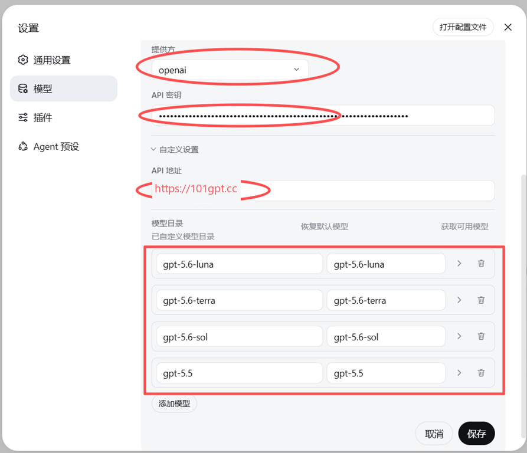

> 🔄 **新手必看 · 重启后生效**：添加并保存提供方后，请**彻底退出并重新打开 DeepSeek Harness**，新的 AI 模型列表才会加载生效；重启后再到模型列表里选择 101gpt 的模型。

### 4、配置 TraeWork（按需选配）

TraeWork 下载地址：<https://www.trae.cn/>。在模型对话框页面，点击模型下拉列表，在菜单中选择「添加模型」，在「模型」界面中点击「添加模型」。

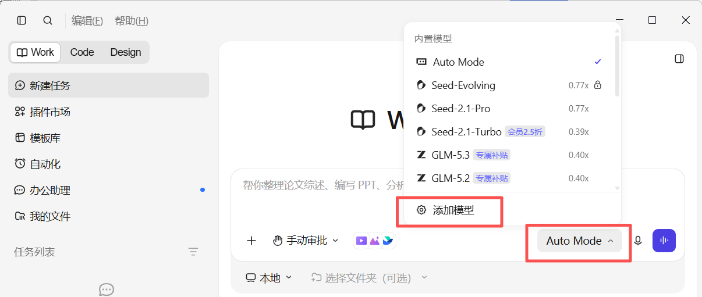
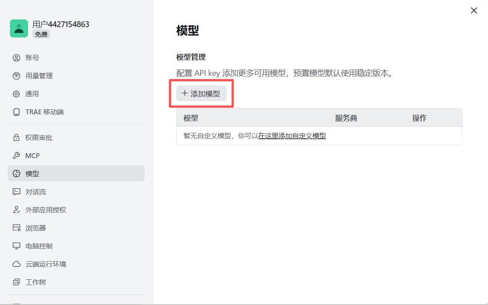
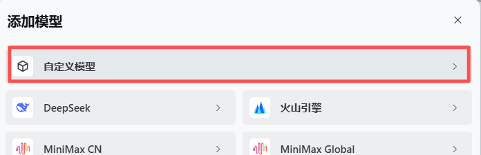

在「添加模型」界面中选择「自定义模型」，在「自定义模型」界面中输入以下信息：

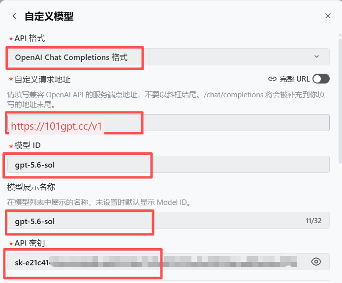
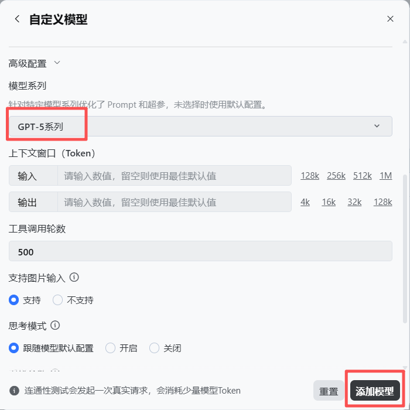

| 字段 | 值 |
|------|-----|
| **API 格式** | OpenAI Chat Completions |
| **自定义请求地址** | `https://101gpt.cc/v1` |
| **模型 ID** | 可写其中之一（gpt-5.6-sol gpt-5.6-terra gpt-5.6-luna gpt-6-astra gpt-6-sol gpt-6-luna gpt-6.1-sol gpt-6.1-terra） |
| **模型展示名称** | 可以与模型 ID 一致 |
| **API 密钥** | 从 https://101gpt.cc 网站获取的密钥 |
| **模型系统** | 可选 GPT-6 系列 |

添加完以后，刚才输入的模型出现在模型列表中，可以在此继续增加或者修改；模型设置完成以后，就可以在对话框下面的模型列表中看到 GPT 模型了。

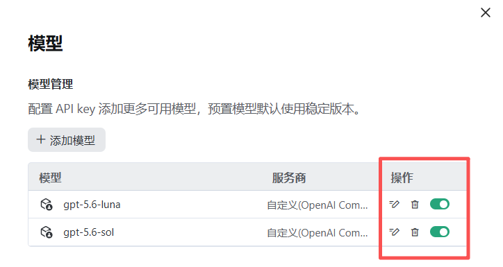
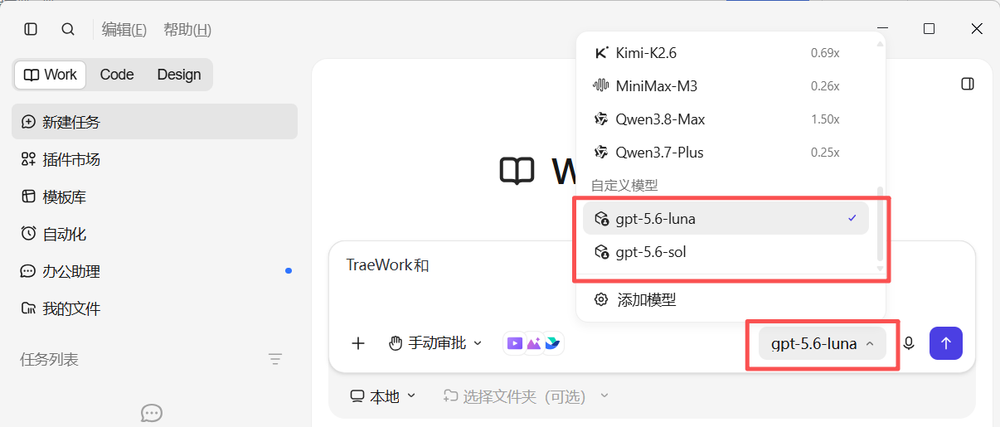

> 🔄 **新手必看 · 重启后生效**：模型设置完成后，建议**彻底退出并重新打开 TraeWork**，新添加的模型才会正式出现在对话模型列表中。

> 💻 **命令行自检（可选）**：Windows 下可用命令行测试 101GPT 支持哪些模型：
> `curl https://101gpt.cc/v1/models -H "Authorization: Bearer 你的API Key"`

---

## 🧠 补充：思维篇

上面 101GPT 注册与多智能体接入流程应该讲得挺细了。有两点思维转变，会带给你不一样的旅程。

### 第一个 —— AI first

> **AI first，AI first，AI first！** 遇事不决，先问 AI。AI 时代，最便捷的解惑决疑的路径就是第一时间问 AI。AI first，电脑问题找 AI，修理 Bug 做批处理找 AI，写文案咨询 AI，做策划问 AI……

### 第二个 —— 高低搭配，干活不累

AI 也可以有团队，AI 也能相互打配合。让 AI 组队更好为你打工。简单任务问题找普通模型，复杂高智难题找一流模型。

> 💡 **性价比策略**：一流模型思考做方案，次流模型细化做执行，这样搭配**性价比高**。一流模型相当于教授专家和博士生，次等模型就是分级的研究生本科生，还有更次等的相当于高中生初中生。你可以搭配着用找感觉。当然欢迎土豪，就都用最精锐的，也是非常非常爽的 😄。

| 模型档次 | 类比 | 用途 |
|----------|------|------|
| 🎓 一流模型 | 教授专家、博士生 | 思考做方案 |
| 🎓 次等模型 | 研究生、本科生 | 细化做执行 |
| 📘 更次等 | 高中生、初中生 | 日常简单任务 |

<p align="center">
  
  <br><em>👆 扫码添加客服微信</em>
</p>

---

## 📞 售后咨询

如有售后疑问可咨询客服：

**WeChat：`hexiaoman42`**

---

<div align="center">

*网页版指南见 [readme.html](readme.html) · 更多 AI 实践案例见仓库其他页面*

</div>
